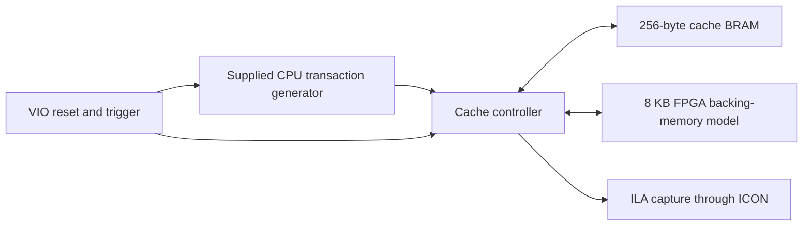

# FPGA Cache Controller

COE758 Digital Systems Engineering course project, completed October 2026 by Shayaan Rashedin.

A VHDL direct-mapped, write-back, write-allocate cache controller for a Xilinx Spartan-3E FPGA. The cache holds 256 bytes in eight 32-byte blocks. A 13-state controller handles read hits, write hits, clean misses, and dirty-block replacement.

## Architecture

CPU addresses split into an 8-bit tag, 3-bit index, and 5-bit byte offset. Each cache slot has its own tag, valid bit, and dirty bit. Block transfers use 32 individual byte operations. A dirty miss writes back the old block using its stored tag, fetches the requested block, and completes the original CPU operation.

## Source and attribution

- `rtl/cache_controller.vhd`: request capture, metadata, hit detection, state transitions and memory output control.
- `rtl/cache_top.vhd`: component instantiation, wiring and ChipScope signal mapping.
- `rtl/sdram_controller.vhd`: synchronous 8 KB backing-memory model implemented using FPGA block-memory resources. It is not an external SDRAM protocol controller.
- `rtl/CPU_gen.vhd`: course-supplied CPU transaction generator by Victor Dumitriu; original attribution retained. It is not claimed as original student code.
- `constraints/cache_constraints.ucf`: clock pin assignment.
- `ip/*.xco`: Xilinx CORE Generator configuration for BRAM, ICON, ILA and VIO; generated vendor components are not claimed as original student implementations.

## Hardware evaluation

The project report documents Spartan-3E ChipScope captures sampled at 50 MHz (20 ns per clock). Reported measurements:

| Operation | Time |
|---|---:|
| Write hit | 60 ns |
| Read hit | 80 ns |
| Clean read miss, total | 2020 ns |
| Dirty write miss, total | 3920 ns |
| Clean read miss penalty above read hit | 1940 ns |
| Dirty write miss penalty above write hit | 3860 ns |

These are course-report measurements, not independently rerun benchmarks or guaranteed timing for other FPGA targets. The four documented cases cover direct cache access, refill, and write-back followed by refill.

## Rebuild and inspect

1. Use Xilinx ISE with Spartan-3E support; the supplied IP configuration targets XC3S500E, FG320, speed grade -5, with CORE Generator 13.4 metadata.
2. Create an ISE project and add the four files in `rtl/`; set `cache_top` as top-level.
3. Regenerate the four vendor cores from `ip/*.xco` using the matching Xilinx toolchain and include their generated implementation files. Proprietary Xilinx core libraries and binaries are not distributed here.
4. Add the clock constraint, checking the pin against the actual board. For the report's measurements the board clock was 50 MHz; the supplied UCF contains a pin assignment only, not a clock-period constraint.
5. Synthesize and implement, program the board, then connect ChipScope. VIO bit 0 resets the cache/generator and bit 1 triggers the next CPU pattern.
6. Wait for CPU ready before triggering another transaction. Use ILA data bit 18 for ready, bit 20 for memory strobe, bits 21–28 for returned data and bit 29 for cache write enable.

## Known scope limits

- Backing memory uses only address bits 12–0, so addresses separated by 0x2000 alias despite the 16-bit interface.
- The CPU generator does not consume ready; requests must be spaced manually.
- Reset invalidates cached blocks without flushing dirty data, and does not reset backing memory.
- There is no automated assertion-based simulation testbench in the supplied project. Hardware captures are the reported validation evidence.
- Generated build outputs, programming bitstreams, the supplied assignment handout, and the report cover containing personal identifiers are excluded from this public source folder.

## Skills demonstrated

VHDL RTL; synchronous digital design; finite-state control; direct-mapped cache organization; tag/index/offset decoding; valid/dirty metadata; write-back and write-allocate behavior; BRAM interfaces; byte-wise block transfers; strobe sequencing; modular hardware integration; Xilinx ISE/CORE Generator; ChipScope ILA/VIO/ICON; waveform interpretation; latency and miss-penalty measurement; technical documentation.

No additional redistribution license is asserted for supplied course code or vendor IP.
